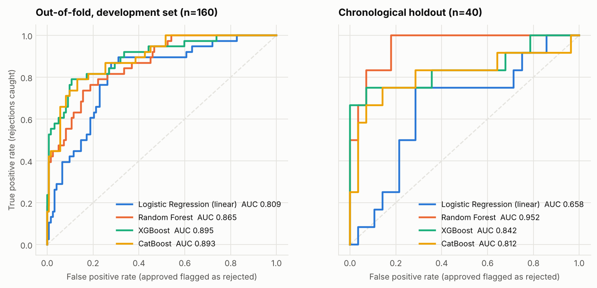
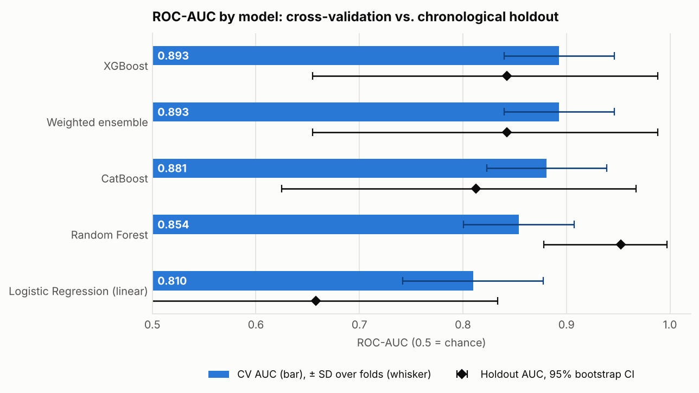
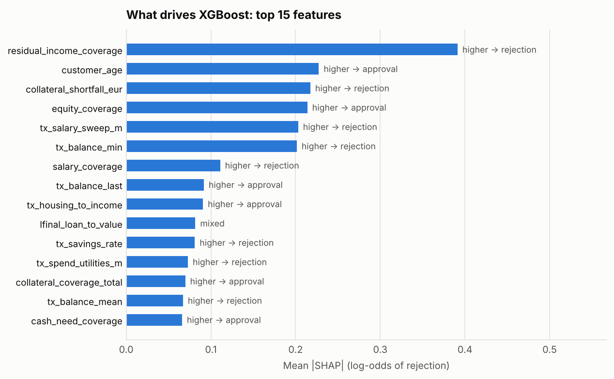
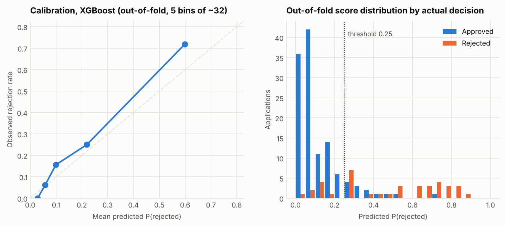

# Model report: predicting mortgage rejection

Target `final_decision` (positive class = rejected). 160 development applications (before 2026-06-25), 40 holdout applications (on or after). 84 features. CV = 5×5 repeated stratified folds, identical for every model.

## Leaderboard

| model                        | cv_auc        |   oof_pr_auc |   oof_log_loss |   oof_brier | holdout_auc_95ci   |   holdout_pr_auc |   holdout_log_loss |   holdout_brier |   fit_seconds |   tune_seconds |
|:-----------------------------|:--------------|-------------:|---------------:|------------:|:-------------------|-----------------:|-------------------:|----------------:|--------------:|---------------:|
| XGBoost                      | 0.893 ± 0.053 |        0.760 |          0.351 |       0.108 | 0.842 [0.65, 0.99] |            0.836 |              0.454 |           0.141 |         0.376 |        185.756 |
| Weighted ensemble            | 0.893 ± 0.053 |        0.760 |          0.351 |       0.108 | 0.842 [0.65, 0.99] |            0.836 |              0.454 |           0.141 |       nan     |        nan     |
| CatBoost                     | 0.881 ± 0.058 |        0.716 |          0.398 |       0.121 | 0.812 [0.62, 0.97] |            0.758 |              0.492 |           0.157 |         0.460 |        229.399 |
| Random Forest                | 0.854 ± 0.053 |        0.711 |          0.398 |       0.126 | 0.952 [0.88, 1.00] |            0.901 |              0.414 |           0.134 |         0.711 |        336.457 |
| Logistic Regression (linear) | 0.810 ± 0.068 |        0.533 |          0.449 |       0.146 | 0.658 [0.47, 0.83] |            0.432 |              0.608 |           0.206 |         0.161 |        166.566 |

- `cv_auc` is the mean ± SD of per-fold ROC-AUC over 25 folds; `oof_*` metrics are computed on pooled out-of-fold predictions and averaged over repeats.
- No-skill reference (always predict the development rejection rate, 0.237): AUC 0.500, log-loss 0.548 (dev) / 0.621 (holdout), Brier 0.181 / 0.214.
- `fit_seconds` is one pipeline fit on 128 rows (boosters include the early-stopping probe and the refit); `tune_seconds` is the whole Optuna study.
- Ensemble weights (non-negative, sum to 1, chosen on out-of-fold log-loss): {'logreg': 0.0, 'random_forest': 0.0, 'xgboost': 1.0, 'catboost': 0.0}. No blend beat XGBoost alone, so the ensemble row is identical to that model.

**Selected model: XGBoost** (highest CV AUC among single models; the holdout was not used to choose).

### Are the differences real?

| comparison                              |   mean_auc_diff | folds_won_by_best   |   corrected_p_value |
|:----------------------------------------|----------------:|:--------------------|--------------------:|
| XGBoost vs Logistic Regression (linear) |           0.083 | 21/25               |               0.034 |
| XGBoost vs Random Forest                |           0.039 | 19/25               |               0.189 |
| XGBoost vs CatBoost                     |           0.012 | 14/25               |               0.649 |
| XGBoost vs Weighted ensemble            |           0.000 | 0/25                |               1.000 |

Corrected resampled t-test (Nadeau–Bengio) on per-fold AUC differences. With 32 validation rows per fold, p-values above 0.05 mean the ranking between those two models is not established by this data.

## Tuned hyperparameters

- **Logistic Regression (linear)** (60 Optuna trials): `{"C": 0.148, "l1_ratio": 0.6717, "scaler": "robust", "corr_threshold": 0.9721, "vif_threshold": 10.0}`
- **Random Forest** (40 Optuna trials): `{"n_estimators": 400, "max_depth": 9, "min_samples_leaf": 1, "max_features": 0.2281, "max_samples": 0.94}`
- **XGBoost** (60 Optuna trials): `{"learning_rate": 0.02289, "max_depth": 3, "min_child_weight": 1.26, "subsample": 0.7999, "colsample_bytree": 0.5864, "reg_lambda": 0.01925, "reg_alpha": 0.2029, "gamma": 0.5273}`; early stopping kept 102 trees
- **CatBoost** (30 Optuna trials): `{"learning_rate": 0.08509, "depth": 5, "l2_leaf_reg": 2.027, "rsm": 0.2716, "subsample": 0.7173, "bootstrap_type": "Bernoulli", "min_data_in_leaf": 5}`; early stopping kept 25 trees

## What drives the predictions (XGBoost)

SHAP on the development set (in-sample attribution), top 15 of 88:

| feature                   |   mean_abs_shap | direction          | family                                |
|:--------------------------|----------------:|:-------------------|:--------------------------------------|
| residual_income_coverage  |          0.3912 | higher → rejection | affordability / liquidity ratios      |
| customer_age              |          0.2275 | higher → approval  | customer & location                   |
| collateral_shortfall_eur  |          0.2174 | higher → rejection | collateral (incl. additional)         |
| equity_coverage           |          0.2139 | higher → approval  | affordability / liquidity ratios      |
| tx_salary_sweep_m         |          0.2031 | higher → rejection | transactions (spend, balance, salary) |
| tx_balance_min            |          0.2014 | higher → rejection | transactions (spend, balance, salary) |
| salary_coverage           |          0.1109 | higher → rejection | affordability / liquidity ratios      |
| tx_balance_last           |          0.0916 | higher → approval  | transactions (spend, balance, salary) |
| tx_housing_to_income      |          0.0906 | higher → approval  | transactions (spend, balance, salary) |
| lfinal_loan_to_value      |          0.0816 | mixed              | final loan terms                      |
| tx_savings_rate           |          0.0810 | higher → rejection | transactions (spend, balance, salary) |
| tx_spend_utilities_m      |          0.0728 | higher → rejection | transactions (spend, balance, salary) |
| collateral_coverage_total |          0.0697 | higher → approval  | collateral (incl. additional)         |
| tx_balance_mean           |          0.0670 | higher → rejection | transactions (spend, balance, salary) |
| cash_need_coverage        |          0.0659 | higher → approval  | affordability / liquidity ratios      |

Share of total attribution by feature family:

| family                                |   sum_mean_abs_shap |   share |
|:--------------------------------------|--------------------:|--------:|
| transactions (spend, balance, salary) |               1.167 |   0.388 |
| affordability / liquidity ratios      |               0.828 |   0.275 |
| collateral (incl. additional)         |               0.429 |   0.143 |
| customer & location                   |               0.294 |   0.098 |
| final loan terms                      |               0.161 |   0.054 |
| negotiation behaviour                 |               0.080 |   0.027 |
| recorded expenses                     |               0.049 |   0.016 |

Runner-up (CatBoost) top 10, as a cross-check that the story is not model-specific:

| feature                       |   mean_abs_shap | direction          | family                                |
|:------------------------------|----------------:|:-------------------|:--------------------------------------|
| residual_income_coverage      |          0.2060 | higher → rejection | affordability / liquidity ratios      |
| collateral_shortfall_eur      |          0.1601 | higher → rejection | collateral (incl. additional)         |
| salary_coverage               |          0.1595 | higher → rejection | affordability / liquidity ratios      |
| customer_age                  |          0.1536 | higher → approval  | customer & location                   |
| equity_coverage               |          0.1400 | higher → approval  | affordability / liquidity ratios      |
| tx_housing_to_income          |          0.1393 | higher → approval  | transactions (spend, balance, salary) |
| tx_balance_min                |          0.1373 | higher → rejection | transactions (spend, balance, salary) |
| tx_balance_std                |          0.0773 | higher → approval  | transactions (spend, balance, salary) |
| tx_spend_housing_m            |          0.0750 | higher → approval  | transactions (spend, balance, salary) |
| neg_has_additional_collateral |          0.0684 | higher → approval  | collateral (incl. additional)         |

### Out-of-sample check on the holdout (40 rows, so noisy)

AUC drop when a whole feature family is shuffled (100 repeats):

| family                                |   n_features |   auc_drop_mean |   auc_drop_std |
|:--------------------------------------|-------------:|----------------:|---------------:|
| affordability / liquidity ratios      |            8 |           0.152 |          0.060 |
| transactions (spend, balance, salary) |           33 |           0.093 |          0.054 |
| collateral (incl. additional)         |            9 |           0.029 |          0.020 |
| final loan terms                      |            6 |           0.013 |          0.010 |
| negotiation behaviour                 |           14 |           0.006 |          0.003 |
| recorded expenses                     |            8 |          -0.003 |          0.003 |
| customer & location                   |            6 |          -0.028 |          0.021 |

Single-feature permutation importance, top 10:

| feature                     |   auc_drop_mean |   auc_drop_std |
|:----------------------------|----------------:|---------------:|
| residual_income_coverage    |          0.0707 |         0.0304 |
| tx_balance_min              |          0.0228 |         0.0132 |
| lfinal_loan_to_value        |          0.0201 |         0.0094 |
| collateral_shortfall_eur    |          0.0156 |         0.0127 |
| equity_coverage             |          0.0145 |         0.0234 |
| tx_balance_last             |          0.0127 |         0.0096 |
| tx_balance_mean             |          0.0109 |         0.0070 |
| tx_salary_sweep_m           |          0.0101 |         0.0130 |
| collateral_coverage_primary |          0.0068 |         0.0039 |
| tx_savings_rate             |          0.0046 |         0.0069 |

## Error diagnostics

Residual = actual − predicted P(rejected), on out-of-fold predictions of XGBoost.

### Calibration

| bin              |   n |   mean_predicted |   observed_rate |
|:-----------------|----:|-----------------:|----------------:|
| (0.0091, 0.0466] |  32 |            0.029 |           0.000 |
| (0.0466, 0.0716] |  32 |            0.058 |           0.062 |
| (0.0716, 0.151]  |  32 |            0.100 |           0.156 |
| (0.151, 0.3]     |  32 |            0.219 |           0.250 |
| (0.3, 0.854]     |  32 |            0.599 |           0.719 |

### Decision threshold

Threshold 0.25 maximises out-of-fold F1 for the rejected class.

- Out-of-fold: TN 109, FP 13, FN 8, TP 30 (recall 79%, precision 70%)
- Holdout: TN 22, FP 6, FN 3, TP 9 (recall 75%, precision 60%)

### Which rejections does the model miss?

`rejection_reason` is used here for diagnosis only; it is never a model input.

| outcome                 |   n |   mean_predicted |   flagged_at_threshold |
|:------------------------|----:|-----------------:|-----------------------:|
| approved                | 122 |            0.115 |                  0.107 |
| existing_debt           |   2 |            0.410 |                  0.500 |
| insufficient_collateral |  26 |            0.526 |                  0.846 |
| insufficient_equity     |   5 |            0.486 |                  1.000 |
| insufficient_income     |   5 |            0.227 |                  0.400 |

### Segments

| segment                       | level          |   n |   observed_rate |   mean_predicted |   auc |   mean_abs_residual |
|:------------------------------|:---------------|----:|----------------:|-----------------:|------:|--------------------:|
| property_type                 | apartment      |  75 |           0.253 |            0.214 | 0.857 |               0.230 |
| property_type                 | detached_house |  28 |           0.321 |            0.208 | 0.901 |               0.266 |
| property_type                 | terraced_house |  57 |           0.175 |            0.180 | 0.953 |               0.164 |
| postal_city                   | 00             |  87 |           0.241 |            0.210 | 0.921 |               0.202 |
| postal_city                   | 01             |  21 |           0.048 |            0.128 | 1.000 |               0.095 |
| postal_city                   | 02             |  52 |           0.308 |            0.216 | 0.837 |               0.278 |
| neg_has_additional_collateral | 0              |  75 |           0.347 |            0.289 | 0.892 |               0.269 |
| neg_has_additional_collateral | 1              |  85 |           0.141 |            0.124 | 0.866 |               0.163 |
| coverage_band                 | < 0.9          |  61 |           0.410 |            0.317 | 0.878 |               0.297 |
| coverage_band                 | 0.9–1.0        |  17 |           0.059 |            0.150 | 1.000 |               0.135 |
| coverage_band                 | 1.0–1.5        |  43 |           0.140 |            0.114 | 0.797 |               0.178 |
| coverage_band                 | > 1.5          |  39 |           0.154 |            0.137 | 0.929 |               0.152 |

### Features most correlated with the residual

A large value means the model systematically under- or over-predicts along that feature.

| feature                       |   spearman_with_residual |
|:------------------------------|-------------------------:|
| tx_balance_mean               |                    0.182 |
| tx_balance_std                |                    0.160 |
| tx_balance_last               |                    0.158 |
| income_coverage               |                    0.157 |
| loan_to_annual_income         |                   -0.157 |
| tx_balance_min                |                    0.151 |
| debt_adjusted_income_coverage |                    0.147 |
| tx_negative_balance_share     |                   -0.146 |

### Ten largest out-of-fold errors

| mortgage_customer_id   | outcome                 |     p |   collateral_coverage_total |   neg_has_additional_collateral |   lfinal_loan_to_value |   tx_savings_rate |   customer_age |
|:-----------------------|:------------------------|------:|----------------------------:|--------------------------------:|-----------------------:|------------------:|---------------:|
| C0761                  | insufficient_income     | 0.047 |                       1.305 |                               1 |                  0.839 |             0.641 |             51 |
| C0566                  | existing_debt           | 0.059 |                       0.787 |                               0 |                  0.970 |             0.917 |             55 |
| C0334                  | insufficient_collateral | 0.079 |                       1.697 |                               1 |                  0.876 |             0.919 |             47 |
| C0351                  | insufficient_collateral | 0.108 |                       1.178 |                               1 |                  0.872 |             0.853 |             45 |
| C0137                  | insufficient_income     | 0.114 |                       0.841 |                               0 |                  0.910 |             0.461 |             36 |
| C0465                  | insufficient_income     | 0.117 |                       0.735 |                               0 |                  0.888 |             0.218 |             40 |
| C0267                  | insufficient_collateral | 0.150 |                       1.263 |                               1 |                  0.794 |             0.892 |             39 |
| C0333                  | insufficient_collateral | 0.195 |                       0.899 |                               0 |                  0.786 |             0.757 |             49 |
| C0486                  | insufficient_income     | 0.251 |                       0.857 |                               0 |                  0.859 |             0.494 |             38 |
| C0833                  | approved                | 0.739 |                       0.811 |                               0 |                  0.930 |             0.921 |             39 |
